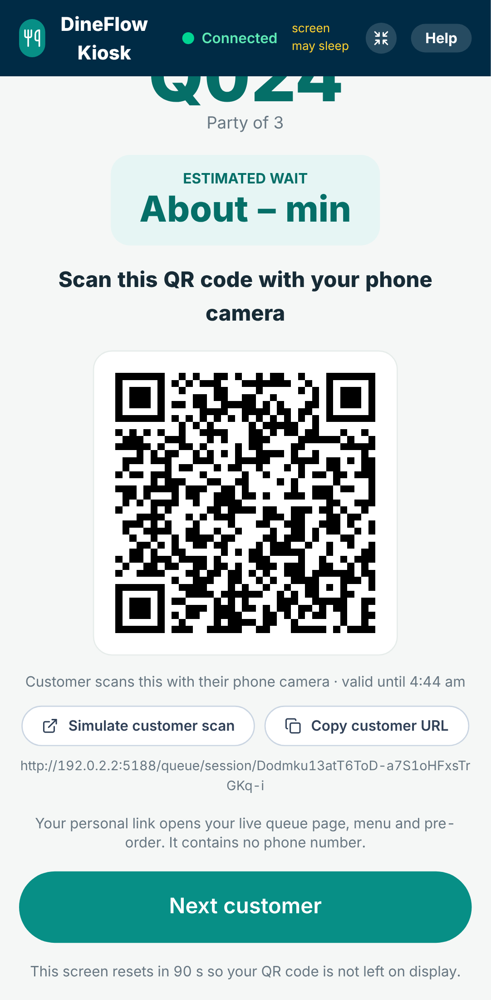
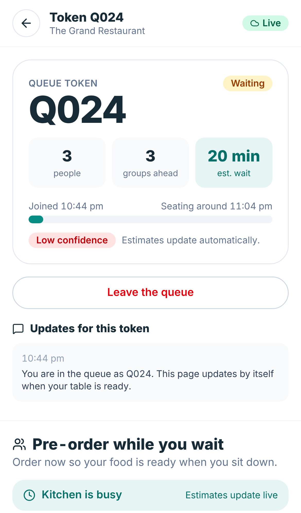
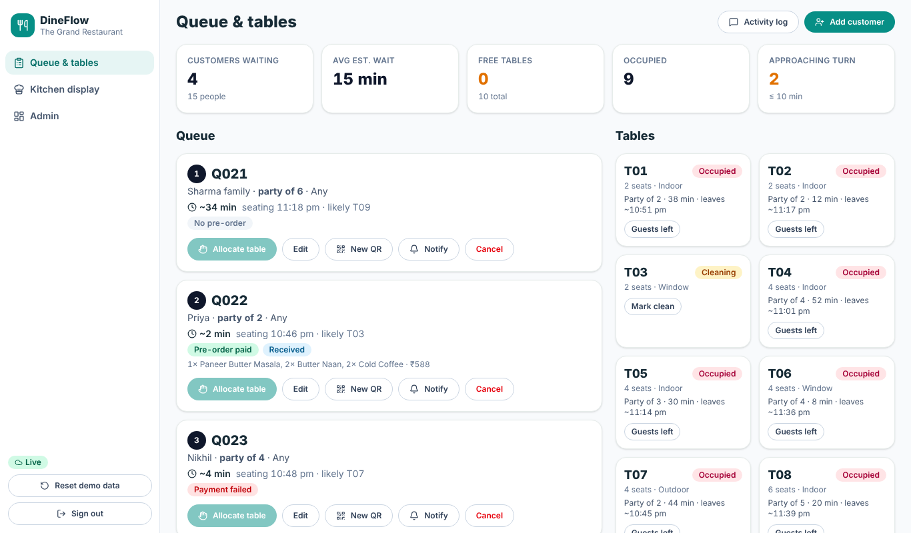
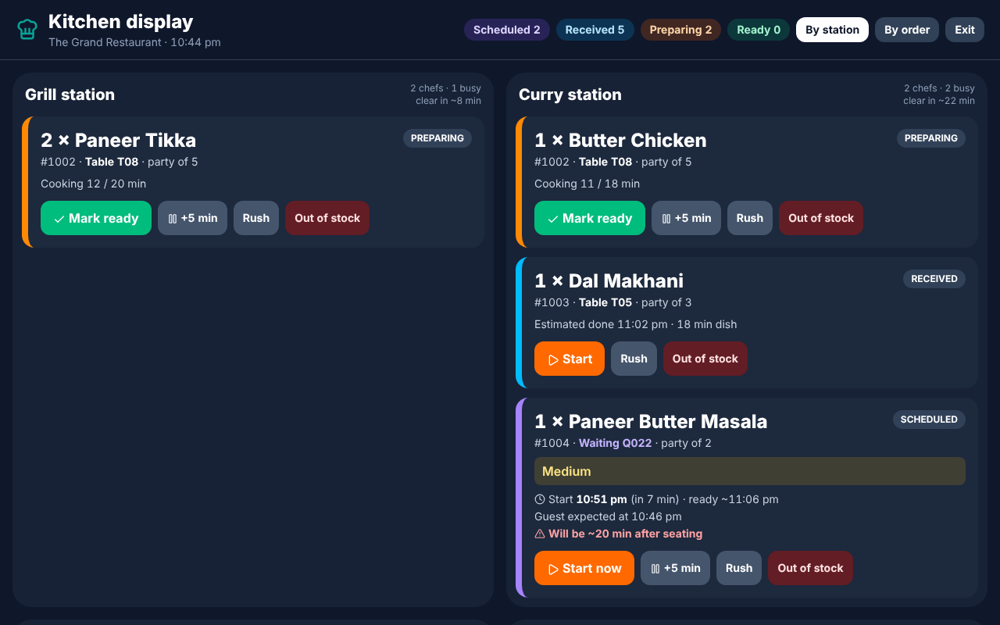

# Menues – Smart Restaurant Management & Digital Transformation Platform

A working demonstration of how a traditional restaurant becomes a digitally managed one. One shared data source connects the customer site, an **entrance kiosk** page, the staff dashboard, the kitchen display and admin/analytics.

**The differentiator:** the waiting queue is connected to advance ordering and to a kitchen scheduler. A guest who pre-orders while waiting has each dish timed to finish when they are expected to sit down.

| Kiosk | Customer phone | Staff | Kitchen |
|---|---|---|---|
|  |  |  |  |

## Start it with one double-click

| Your computer | Double-click |
|---|---|
| Windows | `INSTALL_AND_START.bat` (first time), then `START_DEMO.bat` |
| macOS | `INSTALL_AND_START.command`, then `START_DEMO.command` |
| Linux | `./INSTALL_AND_START.sh`, then `./START_DEMO.sh` |

**QR codes that open from any network:** double-click `START_ONLINE` instead of `START_DEMO`. It starts DineFlow and a free Cloudflare tunnel, prints a public `https://….trycloudflare.com` link and makes every QR code use it, so a customer can scan with mobile data or any Wi-Fi. Keep its window open; Ctrl+C goes back to Wi-Fi-only. Needs internet, no account.

Also: `STOP_DEMO` (stops the server, keeps data) and `RESET_DEMO` (restores the original evening).

The first run needs **Node.js 20 or newer** (https://nodejs.org, LTS) and internet for `npm install`. After that DineFlow runs offline on your Wi-Fi. The launcher checks Node, installs packages, creates `.env`, builds the app, creates and seeds the local database (`data/demo-db.json`), starts the server, prints the addresses and opens your browser:

```
MAIN:            http://localhost:5173
KIOSK:           http://localhost:5173/kiosk
STAFF:           http://localhost:5173/staff      (staff / 1111)
KITCHEN:         http://localhost:5173/kitchen    (kitchen / 2222)
ADMIN:           http://localhost:5173/admin      (admin / 9999)
MOBILE NETWORK:  http://192.168.1.20:5173         (phones on the same Wi-Fi)
PHONE KIOSK:     http://192.168.1.20:5173/kiosk
```

**Demo Mode needs no accounts or keys.** Data lives in `data/` and survives restarts. Manual alternative: `npm install && npm run build && npm start`.

## The two QR codes

| QR | Opens | Purpose |
|---|---|---|
| **Personal queue QR** (shown on the kiosk after registration) | `/queue/session/<random secret>` | Links one customer's phone to their token: live position, wait estimate, notices, menu, pre-order, payment, order tracking. Contains **no phone number**; 192-bit random secret; expires (default 6 h); a staff member can issue a new one. |
| **Table QR** (print from Admin → Tables) | `/table/T05` | Table ordering. Works once a party is seated; a customer's personal session is linked to the table when they are seated. |

QR codes never use `localhost`: they use the public tunnel link (`START_ONLINE`), else the laptop's Wi-Fi address (or **Public base URL** in Admin / `PUBLIC_BASE_URL` in `.env`).

## Admin: what the owner can change (new)

Sign in as `admin` / `9999`, then use the left menu. The full plan is in **[ADMIN_PLAN.md](ADMIN_PLAN.md)**.

* **Menu**: add dishes, change prices, categories, and a **recipe** per dish (raw materials per portion, with live cost and margin).
* **Inventory**: raw materials, stock levels, deliveries, waste, stock counts. Paid orders use stock up; a dish whose ingredient runs out shows **Sold out / Only N left** to customers.
* **Floor plan**: drag tables and areas, change seats, shapes and zones; staff see it live.
* **Prep-time AI**: wait estimates are learned from past orders (ridge regression); shows accuracy vs standard times, retrain, on/off.
* **Loyalty by phone number**: points, tiers and rewards; guests see their balance on their own queue page and pick a reward when paying for a pre-order.

## What is implemented

| Area | Features |
|---|---|
| Kiosk (website page at `/kiosk`) | Full-screen, screen wake lock, idle attract screen, touch keypad registration saved straight to the database, token + personal QR, "Simulate customer scan", "Copy customer URL", scanned indicator, connection indicator, staff-PIN exit |
| Customer | Personal queue page (groups ahead, wait estimate with confidence, in-app notices), menu with filters/customisation/notes, cart, GST, pre-order, payment, live order tracking |
| Pre-order | Dishes are **scheduled** (not cooked early); recalculated if seating time changes; remove dishes before cooking starts (test refund) |
| Table QR ordering | Per-table QR, repeat orders, per-dish and whole-order estimates, live tracking |
| Staff | Queue, tables, add customer (shows QR), new QR, edit party/seating time, priority, allocate/release, seat, walk-ins, fairness-aware suggestions, notification log |
| Kitchen | Full-screen, by station or by order, Start / Ready / Served, +5 min, Rush, out-of-stock, manual override |
| Admin | Menu CRUD, tables CRUD + QR, chefs per station, restaurant, kiosk PIN, base URL, session lifetime |
| Analytics | 10 KPIs, Recharts charts, four process flow diagrams (`/how-it-works`) |
| Payments | Simulated: press **Pay** → "Payment successful" → next page; the paid order, payment record and kitchen tasks are saved in the database and shown on every screen. No payment provider, no card data. |
| Alerts (optional) | Power Automate webhook: queue threshold, delayed dish, failed payment, no-show, table available. See `POWER_AUTOMATE.md`. |
| **No SMS** | There is no SMS code anywhere. Notifications are in-app only. |

## Security model (local server)

- Roles (staff / kitchen / admin) are checked **on the server** with an HttpOnly cookie; the kitchen and public never receive phone numbers, session secrets or payment records, and staff, kitchen and public never receive recipes, ingredient prices, stock history or loyalty balances.
- Customers can act only on their own entry: the personal secret is the proof. Duplicate phone numbers are refused (an existing link is never handed over).
- No payment provider and no card details exist in the app; the Pay button is a simulation.
- Login throttling, request size limits, no path traversal. Change the PINs in `.env` before using it anywhere but a demo.

## Tests

```bash
npm test            # 116 logic checks + 94 server/API/security checks
npm run build && node scripts/e2e.cjs   # 36-check multi-device browser test (needs Playwright)
```

## Honest limitations

- **Demo data is synthetic.** The 10-day history is generated from a fixed seed; analytics illustrate what is measured and prove no improvement.
- **Screen pinning is an OS feature.** DineFlow explains Android App Pinning / iOS Guided Access but cannot bypass OS restrictions.
- **The `.bat`/`.command` launchers were written for Windows/macOS but only the Linux `.sh` path could be run in the build environment.** The shared Node scripts they call were tested.
- **Not tested against live accounts:** Power Automate, Supabase and the Cloudflare tunnel (the sandbox had no access to Cloudflare; the tunnel plumbing was tested with a stand-in) (no credentials/network in the build environment). Each fails safe: the demo keeps working.
- This is a LAN demo server, not hardened internet hosting. Prep-time estimates are learned from past orders once at least 40 dishes are finished (otherwise rule-based); the demo history is generated, so its accuracy figures are optimistic. Reservations are not implemented.
- **Loyalty points are demo-grade:** one account per phone number, no phone verification (no SMS exists), so anyone who knows a number could register with it. Real use would need verification.
- **Inventory is simple:** stock is taken at payment; ingredient yield, partial portions and supplier ordering are not modelled.
- `DATABASE_SCHEMA.sql`/`SEED_DATA.sql` describe the production database; the demo uses a JSON file. They were reviewed, not executed against a live database.

## Troubleshooting

| Problem | Fix |
|---|---|
| "Node.js is not installed" | Install the LTS from nodejs.org, run the launcher again |
| Phone cannot open the MOBILE NETWORK address | Same Wi-Fi? Guest/"client isolation" Wi-Fi blocks phones. Allow Node through the Windows firewall when asked (Private networks). Or use your phone's hotspot for the laptop. |
| Wrong address in QR codes | Admin → Kitchen & settings → Public base URL (or `PUBLIC_BASE_URL` in `.env`) |
| "Port 5173 already in use" | Run `STOP_DEMO`, or set `PORT` in `.env` |
| Something odd | `RESET_DEMO`; logs are in `data/server.log` |

More: `KIOSK_GUIDE.md` · `USER_GUIDE.md` · `DEMO_SCENARIOS.md` · `ENVIRONMENT_VARIABLES.md` · `PROJECT_ARCHITECTURE.md` · `POWER_AUTOMATE.md` · `DATABASE_SCHEMA.sql` · `SEED_DATA.sql`
